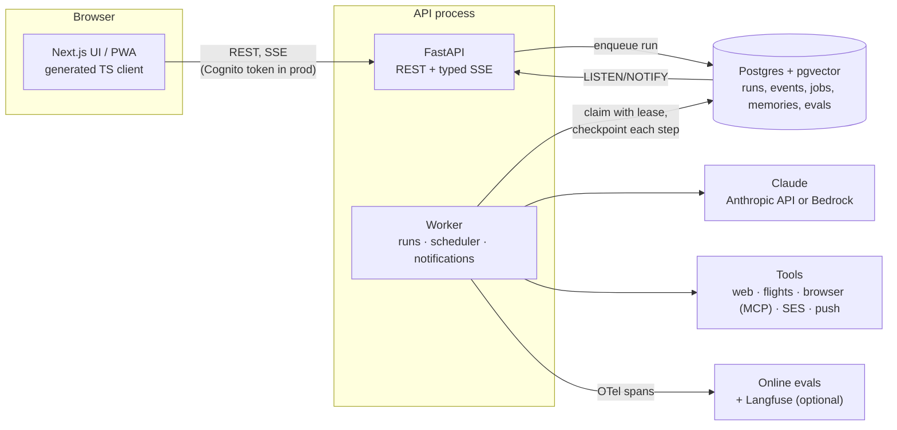
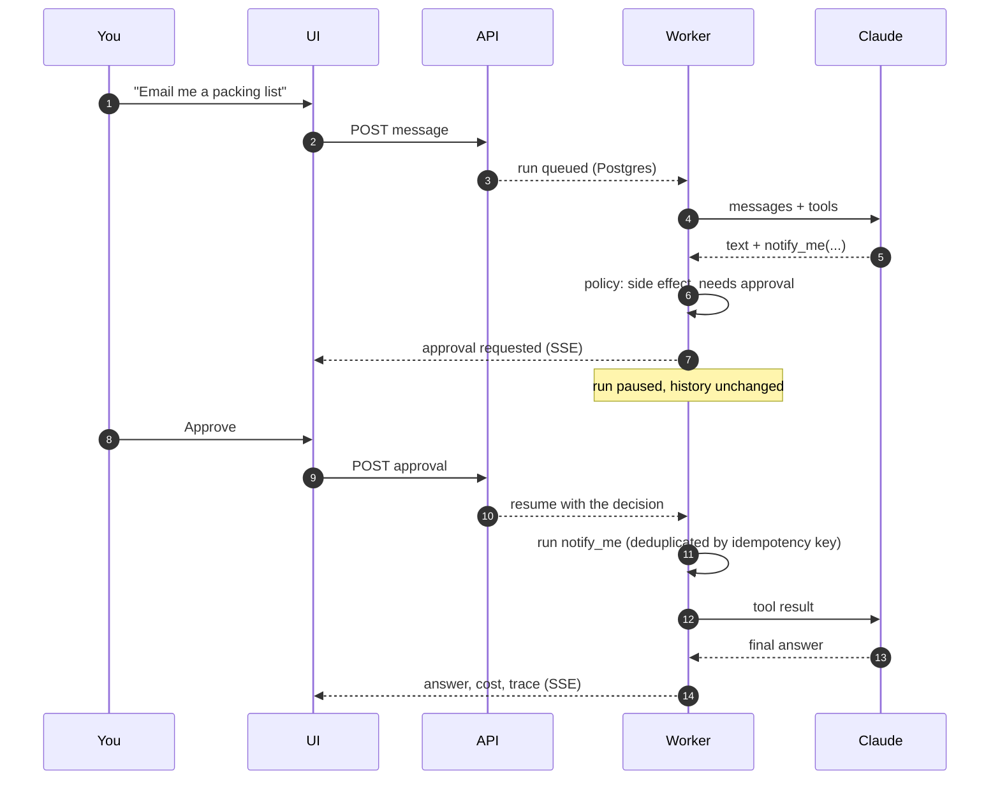
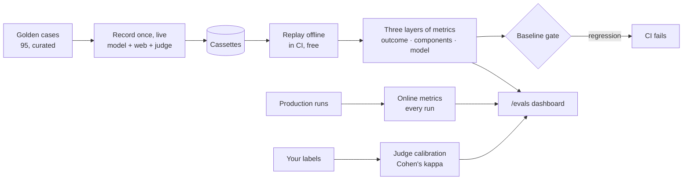

# Kairos

An always-on personal agent. It answers questions with sources, runs scheduled tasks and watches ("tell me when this fare drops under $700"), remembers what you tell it, and acts through tools behind an approval gate. Every run leaves a trace you can inspect, replay and score.

It is also a reference codebase for building agents without a framework. It shows:

- **The core loop:** its own async agent loop, with an append-only history.
- **Durable runs:** runs survive restarts on Postgres leases.
- **Recorded tests:** model and tool calls are recorded at the boundary as cassettes, so tests and evals replay offline for free.
- **An eval framework:** it reads OpenTelemetry traces.

## Try it in two minutes, free

Requirements: [uv](https://docs.astral.sh/uv/), [just](https://just.systems/), Node 24 with pnpm (`corepack enable pnpm`), Docker.

```bash
just sync && just dev   # dependencies, then Postgres with pgvector
```

```bash
just api-demo           # API with a scripted model: no API key, no cost
```

```bash
just web                # open http://localhost:3000
```

A short tour opens on the first visit. The Welcome page (⌘K → "Welcome") has four example prompts. The demo answers each one with a scripted reply, while the real tools run:

- a plan with a live checklist;
- a fare watch to confirm;
- a memory to confirm;
- an email that waits for your approval.

The demo uses its own `kairos_demo` database.

To use a real model, put `ANTHROPIC_API_KEY` in `.env` (copy `.env.example`), run `just migrate`, then `just api` instead of `just api-demo`. The Welcome checklist shows what else you can switch on: web search, flights, email, push and the browser.

## What it does

| | |
|---|---|
| **Chat** | Streams answers with tool cards, a plan checklist and citations. Each turn shows its cost and links to its trace. |
| **Tasks and watches** | Cron or one-shot tasks, plus watches that read a value on a schedule and alert on a condition. The agent proposes them and you confirm. |
| **Approvals** | Every action with a side effect waits in an inbox. There is also an audit log and a kill switch. |
| **Notifications** | Email through Amazon SES, browser push, and a weekly digest. |
| **Memory** | Facts the agent proposes and you confirm, with semantic recall from a local embedding model. |
| **Tools** | Web search and fetch, flights, deals, an isolated Playwright browser, and any MCP server. Content from the web is treated as data, never as instructions, and is screened for prompt injection. |
| **Guard rails** | A daily spend cap, rate limits and budgets per run. |
| **Evals** | 95 golden cases held to a baseline in CI, an LLM judge calibrated against your own labels, and online scoring of production runs. |
| **App** | Works on phones, installs as a PWA, has a ⌘K command palette, and supports light and dark themes. |

## How it works



- **The UI:** it talks to the API only through a client generated from FastAPI's OpenAPI schema. Pydantic models are the single source of truth, including every streaming event.
- **The worker:** it claims a run with a lease (`FOR UPDATE SKIP LOCKED` plus a fencing token). It writes a checkpoint after every step and publishes events that the API streams to the browser. A crashed worker's run is picked up by another; an action whose outcome is unknown pauses for a human instead of being retried.

### A run that needs your approval



### Evals



`kairos_evals` reads OpenTelemetry traces and imports no other Kairos package, so it can evaluate any agent that emits GenAI spans.

More detail:
- [docs/architecture.md](docs/architecture.md): package dependencies and the life of a run.
- [docs/harness.md](docs/harness.md): the loop and its leases.
- [docs/evals.md](docs/evals.md): the eval workflow.
- [ADRs](docs/adr/): every decision with trade-offs.

## Working on it

`just` lists every command. The main ones:

```bash
just check        # what CI runs: lint, types, tests, evals
```

```bash
just gen-client   # after changing an API or event model
```

```bash
just record-demo  # after changing a prompt or a tool schema
```

Tests never reach the network: model calls replay from cassettes and HTTP from `vcrpy`. Live tests and re-recordings cost money and sit behind `LIVE=1` or their own recipes. [CLAUDE.md](CLAUDE.md) has the full conventions.

## Deploying to AWS

One lean CDK stack in `ca-central-1`, costing about $57/month plus model usage:

- **Edge:** CloudFront in front of an internal ALB.
- **App:** one ARM64 Fargate task running the API, worker and web UI.
- **Data:** RDS Postgres.
- **Sign-in:** Cognito with MFA.
- **Monitoring:** alarms and a budget, by email.

Follow [docs/runbook.md](docs/runbook.md). The design and cost table are in [ADR-017](docs/adr/017-deployment.md).

```bash
just deploy <admin-profile> -c owner_email=you@example.com -c cognito_prefix=kairos-abcd
```

## Layout

| Path | Contents |
|---|---|
| `packages/kairos_*` | Python libraries: harness, providers, tools, memory, scheduler, policy, notify, db, telemetry, domain, evals |
| `services/` | Python entrypoints: `api`, `worker`, `browser` (an MCP server) |
| `apps/web` | Next.js UI (the only TypeScript) |
| `infra/` | Local compose file, container images (`docker/`) and the AWS CDK app (`cdk/`) |
| `tests/` | Cross-package and integration tests, eval suites, the scripted demo |
| `docs/` | [Architecture](docs/architecture.md), [evals](docs/evals.md), [runbook](docs/runbook.md), [threat model](docs/threat-model.md), [demo script](docs/demo-script.md) and ADRs |

## Acknowledgements

The durable task worker (SQL leases with a fencing token, lease-guarded checkpoints), stored action reviews, the token-protected Playwright worker and the test layout are modelled on [CopilotKit OpenFuse](https://github.com/CopilotKit/openfuse) (MIT). OpenFuse is TypeScript; Kairos ports the patterns into Python rather than copying code.

The eval framework follows the AWS article "Evaluating AI agents: Real-world lessons from building agentic systems at Amazon".

## License

MIT. See [`LICENSE`](LICENSE).
