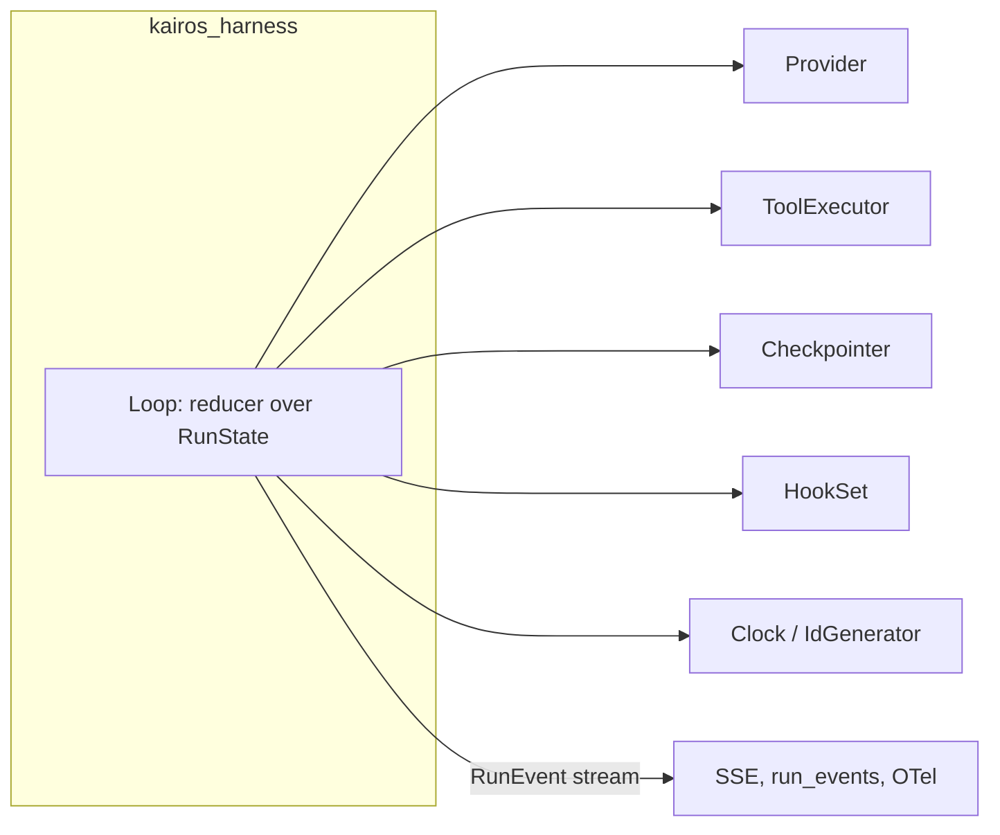

# ADR-001: Own async harness behind a `Harness` Protocol

- **Status:** Accepted (2026-11-16)
- **Milestone:** M1

## Context

Kairos needs an agent loop that survives crashes and redeploys, pauses for approval, enforces budgets, and replays deterministically for evals. The candidates were our own loop, the Claude Agent SDK (Python), Strands Agents and LangGraph. The project rules exclude LangChain from the core.

## Decision

Build our own async core loop in `kairos_harness`, behind a `Harness` Protocol. The Claude Agent SDK and Strands (LangGraph optional) are implemented as adapters of the same Protocol inside `kairos_evals`, so all harnesses run the same tools and eval suites head to head.

## Options

| Option | For | Against |
|---|---|---|
| **Own loop** (chosen) | Checkpointing, pause-on-approval, lease guards, budgets and replay all sit in the middle of the loop, and we control the middle. Readable as a reference. | We write and maintain the loop, context management and provider translation. |
| Claude Agent SDK | The Claude Code harness as a library: loop, context management, hooks, subagents, MCP, built-in file and shell tools. | It owns session state and the loop, so per-step checkpoints into our Postgres and lease-guarded side effects would have to be bolted on from outside. Its built-in tools are aimed at coding work. |
| Strands Agents | AWS-native, model-agnostic, good Bedrock fit. | Same ownership problem: the loop and session state are the framework's. |
| LangGraph | Has a durable checkpointing model. | Depends on LangChain core types, which the project excludes. |

The descriptions of the three frameworks are from their public positioning. Their current APIs are verified against docs when the adapters are written (M5), not now.

## Design

- **`Harness` Protocol:** `run(request: RunRequest, ctx: RunContext) -> AsyncIterator[RunEvent]`.
- **Step:** one model call plus the tool batch it requested. After every step the loop appends events, writes a checkpoint, checks budgets and checks its lease.
- **Seams:** `Provider`, `ToolExecutor`, `Checkpointer`, `Clock`, `IdGenerator` and `HookSet` are Protocols, each with an in-memory implementation for tests and a real one. This is what makes cassettes, the fake clock and seeded run IDs possible.
- **Parallel tools:** independent calls run in an `asyncio.TaskGroup`. All `tool_result` blocks return in one user message. A failing tool yields an error result; it does not cancel its siblings.
- **Stop reasons:** `completed`, `budget_exceeded`, `awaiting_approval`, `awaiting_input`, `cancelled`, `refused`, `failed`.
- **Resume rule:** on resume, a tool call with no recorded result is re-run only if the tool is idempotent (same idempotency key). Otherwise it is marked `uncertain` and the run pauses for a human. This is OpenFuse's "no hidden retry" rule.

## Constraints from the current Claude API (verified 2026-11)

- Thinking cannot be disabled on `claude-opus-5-5`; `output_config.effort` is the cost control.
- Forced `tool_choice` (`any` / `tool`) and sampling parameters return 400. The loop uses `auto` and strict tool schemas.
- Thinking blocks must be replayed unchanged, in the conversation that produced them. **History is therefore append-only**, and compaction starts a new epoch instead of rewriting turns.
- `stop_reason: "refusal"` is a normal outcome and maps to the `refused` stop reason.

## Consequences

- We own correctness of the loop; the crash/resume integration tests in M1 are the safety net.
- Comparing against the SDK adapters in evals tells us, with numbers, whether owning the loop keeps paying off.
