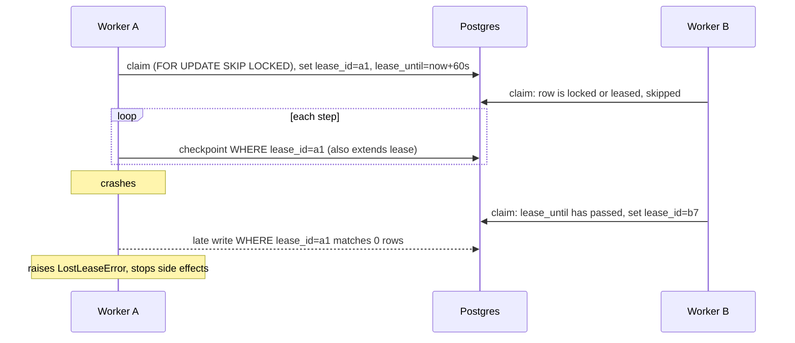

# ADR-003: Durable queue on Postgres leases, written by hand

- **Status:** Accepted (2026-11-16)
- **Milestone:** M1 (runs), M3 (scheduled jobs)

## Context

Runs and scheduled jobs must execute exactly once at a time, survive worker crashes and redeploys, and never double-fire. Options: hand-written Postgres leases, the `procrastinate` library, Temporal (Python SDK), or AWS Step Functions.

## Decision

Postgres is the queue. The lease logic is written by hand in `kairos_db` and `services/worker`, following the pattern in OpenFuse's task worker.

## Options

| Option | For | Against |
|---|---|---|
| **Postgres leases** (chosen) | One datastore. Enqueue and state change commit in one transaction. Identical in tests, local dev and Fargate. Small enough to read in one sitting. | We own the edge cases (clock skew, long steps, shutdown). |
| procrastinate | Mature; uses the same Postgres mechanism. | Hides the part this codebase is meant to demonstrate, and run-level checkpoints are still ours to build on top. |
| Temporal | Strongest durability model available. | Needs a cluster or Temporal Cloud (paid). Its deterministic-workflow rule fits poorly around a streaming LLM loop. Heavy for one tenant. |
| Step Functions | Managed, pay per use. | No local equivalent, ties the core to AWS, poor fit for token streaming and multi-day approval pauses. |

## Design

- **Claim:** `UPDATE runs SET status='running', lease_id=:new, lease_until=:now + :ttl, attempts=attempts+1 WHERE id IN (SELECT id FROM runs WHERE <due> ORDER BY … FOR UPDATE SKIP LOCKED LIMIT :n) RETURNING *`. "Due" means queued, or running with an expired lease.
- **Fencing token:** each claim generates a fresh `lease_id`. Every later write by that worker (checkpoint, event append, completion) is conditioned on it. A write that matches zero rows raises `LostLeaseError`, and the worker abandons the run without further side effects.
- **Heartbeat:** checkpoints extend the lease; a background task extends it during long model or tool calls.
- **Guard before side effects:** the worker re-checks its lease immediately before any non-idempotent tool call.
- **Wake-up:** `LISTEN/NOTIFY` wakes idle workers on enqueue. Polling is the fallback and the only thing correctness depends on.
- **Time:** the database clock (`now()`) decides lease expiry, so worker clock skew does not matter. Tests inject a clock at the repository layer.
- **Shutdown:** on SIGTERM the worker stops claiming, lets the current step reach its checkpoint, then releases the lease.

## Consequences

- No extra infrastructure, locally or in production.
- Throughput is bounded by Postgres, which is far above what a single-tenant agent needs.
- If Kairos ever needs cross-service sagas or very long timers at scale, Temporal is the upgrade path; the `Checkpointer` Protocol keeps that change local.
