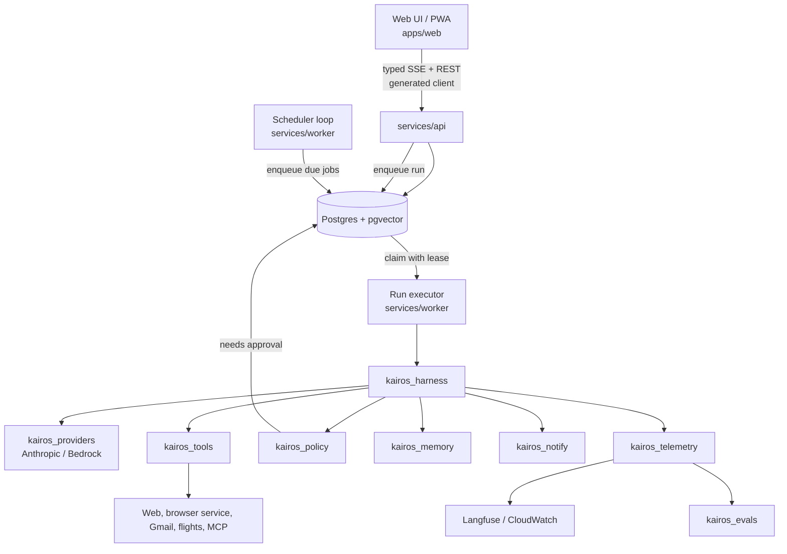
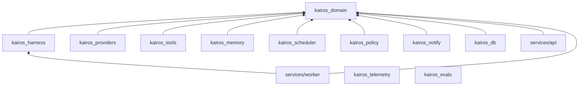
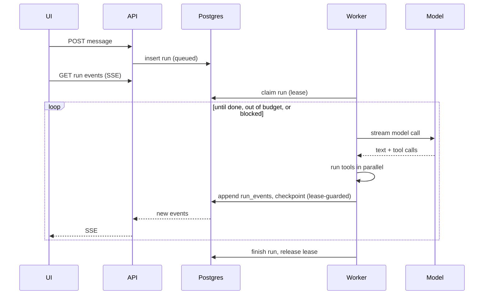

# Architecture

This page is the map. `PLAN.md` has the full spec; `docs/adr/` has the reasoning behind each choice.

## System

## Package dependencies

Arrows point from a package to what it may import. `kairos_evals` and `kairos_telemetry` import no other Kairos package.

The harness depends on Protocols it defines (`Provider`, `ToolExecutor`, `Checkpointer`), not on `kairos_providers`, `kairos_tools` or `kairos_db`. The worker wires the concrete implementations together.

## Life of a run

## Decisions

| ADR | Decision |
|---|---|
| [001](adr/001-own-harness.md) | Own async harness behind a `Harness` Protocol; SDKs are comparison adapters |
| [002](adr/002-streaming-protocol.md) | Typed SSE from Pydantic models, AG-UI-aligned names |
| [003](adr/003-durable-queue.md) | Postgres leases with a fencing token, written by hand |
| [004](adr/004-repository-layout.md) | One monorepo; `kairos_evals` stays extractable |
| [005](adr/005-cassettes.md) | Cassettes at the provider boundary and at HTTP level |
