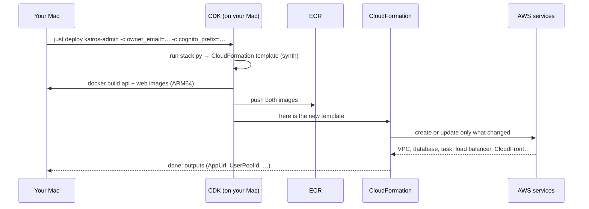

# How Kairos runs on AWS: a guide for newcomers

This guide explains, in plain language, what happens when Kairos is deployed to AWS. It covers:

- what each piece is;
- where it physically lives;
- what it costs;
- where to look for it in the AWS console.

It describes **this** project's setup, with real names and sizes, not AWS in general.

Companion documents:
- [runbook.md](runbook.md): step-by-step commands for deploying, fixing and restoring.
- [first-deploy.md](first-deploy.md): what went wrong on the first deploy, how each problem was tracked down, and the lessons.
- [adr/017-deployment.md](adr/017-deployment.md): why it is designed this way, with the exact costs.

---

## 1. The one-paragraph version

Your code is packed into two **containers**: sealed boxes holding the app and everything it needs to run. They are built on your Mac with Docker and uploaded to an AWS storage area for container images (**ECR**). AWS then runs them on its own computers, using a service called **ECS Fargate**, inside your own private network in Canada (a **VPC**). Data that must survive restarts goes into a managed **Postgres database (RDS)**. Visitors reach the app through **CloudFront**, AWS's global front door, which adds HTTPS and passes requests to a traffic router (the **load balancer**). That router hands them to the containers. Sign-in is handled by **Cognito**. Your API keys sit in **Secrets Manager**. If something goes wrong, **CloudWatch** alarms email you. One AWS tool, **CloudFormation**, creates all of this from a description written in Python with the **CDK**.

```mermaid
flowchart LR
  You["You<br/>(browser or phone)"] -- "HTTPS" --> CF["CloudFront<br/>global front door"]
  subgraph AWS["Your AWS account · Canada (Central), ca-central-1"]
    subgraph VPC["Your private network (VPC)"]
      ALB["Load balancer<br/>(internal)"]
      subgraph Task["One Fargate task (ARM64, 0.5 vCPU, 2 GB)"]
        Web["web container<br/>Next.js :3000"]
        Api["api container<br/>FastAPI + worker :8000"]
      end
      DB[("RDS Postgres<br/>db.t4g.micro, 20 GB")]
    end
    SM["Secrets Manager<br/>kairos/app"]
    COG["Cognito<br/>sign-in + MFA"]
    CW["CloudWatch<br/>logs + alarms"]
    ECR["ECR<br/>container images"]
  end
  CF -- "private link" --> ALB
  ALB -- "/api/*" --> Api
  ALB -- "everything else" --> Web
  Api --> DB
  Api -. "reads keys at start" .-> SM
  Api -- "model calls" --> Anthropic["Anthropic API"]
  You -. "sign in" .-> COG
  Api --> CW
  ECR -. "images pulled at start" .-> Task
```



---

## 2. First, some vocabulary

### AWS account

Your account (ID `681465910603`) is the container for everything you create, and the thing AWS bills. Since M8, it is also the "management account" of a one-account **AWS Organization**. That was created when you enabled IAM Identity Center, costs nothing, and changes nothing day to day.

### Region and Availability Zone

- **A region** is a geographic area where AWS has data centres. Kairos uses **Canada (Central), code `ca-central-1`**, near Montréal ([ADR-006](adr/006-region.md)). Everything stored for Kairos stays in this region.
- **An Availability Zone (AZ)** is one or more separate data centres within a region, with their own power and network. Your account's zones are `ca-central-1a`, `ca-central-1b` and `ca-central-1d`. The network spans `a` and `b`.

### Kubernetes? Not here

You may have heard of Kubernetes, the popular system for running many containers across many machines. It is powerful but complex to run, and AWS's managed version (EKS) costs about $73 a month before running a single container. Kairos uses **ECS Fargate** instead: AWS's simpler container service, where you only describe *what* to run and AWS picks the machines. For one app with two containers, that is the right size.

### Containers, images and Docker

- **An image** is a frozen, self-contained package: an operating system layer, Python or Node, the libraries, and your code. Think of it as a recipe already cooked and vacuum-sealed.
- **A container** is a running copy of an image. You can start many containers from one image, and each starts identical every time.
- **Docker** is the tool on your Mac that builds images from a recipe file called a **Dockerfile**. Kairos has two:
  - [`infra/docker/api.Dockerfile`](../infra/docker/api.Dockerfile) makes the **api** image: Python 3.13, the API and worker code, and the small embedding model used for memory search.
  - [`infra/docker/web.Dockerfile`](../infra/docker/web.Dockerfile) makes the **web** image: Node 24 and the built Next.js UI.

Containers solve "it works on my machine": the exact environment you tested is what runs in AWS.

### Infrastructure as code: CDK and CloudFormation

You don't click resources into existence in the console; they are described in code:

- [`infra/cdk/src/kairos_infra/stack.py`](../infra/cdk/src/kairos_infra/stack.py) describes everything in Python, using the **AWS CDK** (Cloud Development Kit).
- `cdk synth` turns that Python into a **CloudFormation template**: a long JSON list of resources.
- **CloudFormation** is the AWS service that reads the template and creates, updates or deletes resources to match it. The whole set is called a **stack**; yours is named `KairosProd`.

This means your infrastructure is versioned in git and reviewed like code. A redeploy changes only what changed, and a failed deploy rolls back by itself.

**Bootstrapping** (`cdk bootstrap`, done once) created a helper stack called `CDKToolkit`. It holds an S3 bucket and an ECR repository where deploys upload their files, and the roles CloudFormation uses to deploy.

---

## 3. Every piece, explained

### Your private network: VPC, subnets and security groups

**A VPC** (Virtual Private Cloud) is a private network that AWS fences off for you. Kairos's VPC is split into **subnets**, smaller address ranges, three kinds in each of two AZs:

| Subnet group | What lives there | Can reach the internet? |
|---|---|---|
| `public` | The Fargate task | **Out only**: the task calls the Anthropic API and pulls its images. Nothing on the internet can start a connection to it. |
| `edge` | The load balancer | No. It is reached privately by CloudFront. |
| `data` | The Postgres database | No route in or out at all. |

**Security groups** are firewalls around each resource. Kairos's rules form a chain, and anything not listed is refused:

```
CloudFront ──▶ load balancer (port 80) ──▶ task (ports 3000, 8000) ──▶ database (port 5432)
```

There is deliberately no **NAT gateway**, the usual way private machines reach the internet. One would cost about $37 a month for no real benefit here.

### Where your containers run: ECS Fargate

- **ECS** (Elastic Container Service) is AWS's container scheduler.
- **Fargate** is the mode where AWS supplies and maintains the computers, so you never see or patch a server.
- **A task definition** is the plan: which images, how much CPU and memory, environment variables, secrets and log settings. Kairos runs **one task** with both containers, on **ARM64** (AWS Graviton processors, about 20% cheaper):
  - **0.5 vCPU and 2 GB of memory**, shared by the two containers.
  - **20 GB of temporary disk.** It is **wiped whenever the task restarts**, which is why nothing important is kept on it.
- **A service** keeps the task running: if it crashes or fails its health check, ECS starts a fresh one. During a deploy, ECS stops the old task and starts the new one. That causes about two minutes of downtime, but it means two copies of the worker never overlap.

**The api container** runs everything that is "always on":
- the FastAPI server that the web UI talks to;
- the **worker**, which runs agent tasks, fires scheduled jobs and watches, sends notifications, and scores runs for online evals.

On start, it applies any database migrations, then serves requests.

**The web container** serves the Next.js pages.

**Where the containers are created:**
1. **Built on your Mac.** `just deploy` asks Docker to build both images from the Dockerfiles.
2. **Uploaded to ECR**, the repository `cdk-hnb659fds-container-assets-681465910603-ca-central-1`.
3. **Run on AWS's machines.** When ECS starts the task, Fargate pulls the images from ECR and starts the containers, in your VPC's public subnet in `ca-central-1a` or `ca-central-1b`.

### The traffic router: Application Load Balancer (ALB)

The ALB receives each request and decides which container gets it:
- paths starting with **`/api/`** go to the api container;
- **everything else** goes to the web container.

It checks both containers every 30 seconds (`/api/health` and `/`) and only sends traffic to healthy ones. It is **internal**: it has no public address at all.

### The front door: CloudFront

CloudFront is AWS's global network of edge locations, the front door your browser actually talks to:

- **HTTPS:** it provides HTTPS with its own certificate, on an address like `https://d1234abcd.cloudfront.net`. No custom domain is needed.
- **Private origin:** it reaches the internal ALB over a private connection, a **VPC origin**, so the load balancer is never exposed.
- **Caching:** it caches the web UI's static files (`/_next/static/…`) close to visitors. Everything dynamic (`/api/…`, pages) passes straight through.
- **Live streams:** answers stream to the browser over long-lived connections (SSE), and the API sends a small "ping" every 15 seconds so they aren't cut off.

### The database: RDS Postgres

**PostgreSQL** ("Postgres") is the open-source database Kairos uses for everything persistent:
- conversations and runs;
- the step-by-step run events behind live streaming and traces;
- scheduled jobs and watches;
- approvals and the audit log;
- memories, with the **pgvector** extension for similarity search;
- eval results.

**RDS** (Relational Database Service) is AWS running Postgres for you. AWS handles installation, patching, backups and disk failures; you get a connection address.

| Setting | Value | What it means |
|---|---|---|
| Version | PostgreSQL 17.9 | Current major version. |
| Size | `db.t4g.micro` | A small "burstable" ARM machine: 2 vCPUs that can sprint briefly, and 1 GB of memory. Plenty for one person. |
| Storage | 20 GB on gp3 SSD, growing automatically to 50 GB | The database files. The "low storage" alarm emails you below 2 GB free. |
| Encryption | On, with an AWS-managed key | Data on disk and in backups is encrypted. |
| Location | One AZ, inside the isolated `data` subnets | A single copy rather than a standby in a second AZ; the standby would double the price. |
| Backups | Automatic daily snapshots plus continuous change logs, **kept 7 days** | You can restore to any second in the last week ([runbook §5](runbook.md#5-restore-the-database)). |
| Protection | Deletion protection on, and a final snapshot if the stack is ever removed | Nobody can delete it by accident, including a mistaken deploy. |

**Where is the data stored, physically?** On encrypted SSD volumes attached to the database machine, in one data centre of `ca-central-1`. Backups are kept by AWS in S3 within the same region. They are managed for you and don't appear in your own buckets; you see them in the RDS console under **Automated backups** and **Snapshots**.

**Who can connect?** Only the Kairos task. The database has no public address, sits in subnets with no internet route, and its firewall admits only the task. Its password was generated by AWS and is kept in Secrets Manager; nobody ever typed it.

### Secrets: Secrets Manager

Secrets Manager is an encrypted vault for passwords and API keys. Kairos has two secrets:

| Secret | Contents | Who fills it |
|---|---|---|
| `kairos/app` | `ANTHROPIC_API_KEY`, `TAVILY_API_KEY`, `SERPAPI_API_KEY`, `KAIROS_VAPID_PUBLIC_KEY`, `KAIROS_VAPID_PRIVATE_KEY` | **You**, in the console after the first deploy. An empty value leaves that feature off. |
| The database secret (name starts with `PostgresSecret…`) | Database username and password | AWS, automatically. |

When the task starts, ECS reads both secrets and hands the values to the api container as environment variables. Keys never appear in the code, the images, the CloudFormation template or git. Because values are read **at start**, changing a key needs a task restart (the runbook's `--force-new-deployment` command).

### Sign-in: Cognito

Cognito is AWS's user directory and login service. Kairos's **user pool**:

- starts with **one user, you**, created by the deploy with your email address; you can invite more people from the app's **Users** page, and each gets their own private chats, tasks and memories;
- allows **no self sign-up**, so nobody else can create an account;
- requires **multi-factor authentication** with an authenticator app (TOTP), and passwords of at least 12 characters.

When you open the app, the web UI sends you to Cognito's sign-in page at `https://kairos-vr7q.auth.ca-central-1.amazoncognito.com`. After sign-in, your browser holds a short-lived **access token** (valid one hour, renewed automatically). The API checks that token on every request; without a valid one, it answers nothing.

### Email: SES

Amazon **SES** (Simple Email Service) sends Kairos's emails: alerts, the weekly digest, and messages you approve. Every email is sent **from your address**. SES starts in a "sandbox" that only delivers to addresses that have been **verified** (the owner clicked a link from AWS). When you invite someone, Kairos asks SES to send them that link; until they click it, they get push notifications and the in-app list, but no email.

### Watching over it: CloudWatch, SNS and Budgets

- **CloudWatch Logs:** everything the containers print, kept **one month**. To view it, open CloudWatch → Log groups, then the group named in the deploy's `LogGroup` output, or run `aws logs tail`.
- **CloudWatch Alarms:** five checks that email you:
  - the API returning server errors;
  - the API failing its health check;
  - the web container failing its health check;
  - the database low on disk;
  - the database's CPU stuck high.
- **SNS** (Simple Notification Service): the email "topic" the alarms send to. AWS emails you once to **confirm the subscription**; until you click that link, alarms reach no one.
- **AWS Budgets:** `kairos-monthly`, $80 a month. It emails you when actual spending passes 80%, or when the forecast passes 100%.

Model spending (the Anthropic API) is billed by Anthropic, not AWS. Kairos caps it at **$5 a day** by itself.

### Who may do what: IAM and IAM Identity Center

**IAM** (Identity and Access Management) controls permissions in AWS.

**IAM Identity Center** is how **you** sign in:
- In the browser, through the access portal at `https://d-9d674a4b3c.awsapps.com/start`.
- In the terminal, with `aws configure sso` and the profile `kairos-admin`. That gives temporary credentials, so there is no long-lived key to leak.

**IAM roles** are permissions that AWS services assume. The deploy creates a few:

| Role | Used by | Allowed to |
|---|---|---|
| Task execution role | ECS, when starting the task | Pull the images, read the two secrets, write logs |
| Task role | The running app | Send email through SES (to and from you only) |
| CDK roles (from bootstrap) | CloudFormation | Create and update the stack's resources |

---

## 4. What happens when you run `just deploy`



1. **Synthesize.** CDK runs [`stack.py`](../infra/cdk/src/kairos_infra/stack.py) and writes the template into `infra/cdk/cdk.out/`. The lookups it needed from your account are cached in [`infra/cdk/cdk.context.json`](../infra/cdk/cdk.context.json): your AZs, and CloudFront's address list.
2. **Build and upload images.** Docker builds both images on your Mac. That's fast because your Mac and the AWS machines are both ARM. CDK then uploads them to ECR.
3. **Deploy the template.** CloudFormation compares the new template with what exists and makes only the needed changes.
   - **The first deploy** creates about 70 resources and takes 20–30 minutes. RDS and CloudFront are the slow ones.
   - **Later deploys** usually take a few minutes, mostly replacing the task.
4. **Safety net.** If the new task fails its health checks, ECS's **circuit breaker** rolls back to the previous version. If CloudFormation hits an error, it undoes the whole update.

---

## 5. Life of a request

When you send a chat message from your phone:

1. **Your browser** sends `POST https://<your-app>.cloudfront.net/api/threads` with your access token.
2. **CloudFront** receives it at the nearest edge location and forwards it over the VPC origin to the internal load balancer.
3. **The load balancer** sees `/api/…` and passes it to the api container on port 8000.
4. **The API** checks your token, stores the message and a new run in **Postgres**, and returns.
5. **The worker**, inside the same container, claims the run, calls the **Anthropic API** over the internet, runs any tools, and writes each step back to Postgres.
6. **Your browser** stays connected to `/api/runs/…/events` and receives the answer as it streams. A step that needs your approval stops the run and shows a card until you decide.

---

## 6. Where everything lives: a map

| What | Where | How long it lasts |
|---|---|---|
| Source code | GitHub, `varunramakanth/kairos` (private) | Forever, in git |
| Container images | ECR in `ca-central-1` | Until removed; old images cost $0.10 per GB-month |
| Running app | Fargate machines in `ca-central-1a` or `1b` | Replaced on every deploy or restart |
| Temporary files in the task | The task's 20 GB disk | **Lost** on restart |
| Conversations, jobs, memories, evals | RDS Postgres disk in one `ca-central-1` data centre | Until deleted; backups for 7 days |
| Database backups | AWS-managed S3 in `ca-central-1` | 7 days, plus a final snapshot if the stack is removed |
| API keys | Secrets Manager `kairos/app`, `ca-central-1` | Until changed |
| Your login | Cognito user pool, `ca-central-1` | Kept even if the stack is removed |
| Logs | CloudWatch Logs, `ca-central-1` | 1 month |
| Static web files (cached copies) | CloudFront edge locations in North America and Europe | Refreshed on deploy |
| Infrastructure description | `infra/cdk/` in git, and CloudFormation stack `KairosProd` | Versioned in git |

What leaves Canada:
- **Your prompts and tool results**, which go to Anthropic's API for the model to answer.
- **Cached static web files** at CloudFront's edge locations.

Everything stored stays in `ca-central-1`.

---

## 7. What it costs, per month

About **$59** on AWS, from the `ca-central-1` price list (details in [ADR-017](adr/017-deployment.md#cost-ca-central-1-on-demand-730-hmonth)):

| Item | ≈ per month |
|---|---|
| Load balancer | $18.70 |
| Fargate task (0.5 vCPU, 2 GB, ARM) | $18.70 |
| RDS database plus 20 GB of storage | $15.70 |
| One public IPv4 address (the task's) | $3.65 |
| Secrets, alarms, logs, image storage | ≈ $2 |
| CloudFront, Cognito, SNS email, budget, VPC origin | free at this size |

Plus Anthropic model usage, capped at $5 a day by the app and typically a few dollars a month. AWS bills the account monthly; **Billing and Cost Management → Bills** shows the detail, and the budget emails you early.

---

## 8. Finding things in the AWS console

Always check the region selector at the top right says **Canada (Central)**; most services only show resources in the selected region.

| To see | Go to |
|---|---|
| Is the app running? | **ECS** → Clusters → the Kairos cluster → Services → Tasks (Running) |
| App logs | **CloudWatch** → Log groups → the Kairos group → streams `api/…` and `web/…` |
| Alarms | **CloudWatch** → Alarms |
| The database, its backups | **RDS** → Databases (and Automated backups, Snapshots) |
| API keys | **Secrets Manager** → `kairos/app` → Retrieve secret value |
| Your login, MFA | **Cognito** → User pools → the Kairos pool → Users |
| The app's address | **CloudFormation** → `KairosProd` → Outputs → `AppUrl` |
| What the deploy created | **CloudFormation** → `KairosProd` → Resources |
| Container images | **ECR** → Repositories |
| Spending | **Billing and Cost Management** → Bills, Cost Explorer, Budgets |

---

## 9. What keeps it safe

- **One way in:** CloudFront, over HTTPS. The load balancer, task and database have no public entry point.
- **Sign-in:** a valid Cognito sign-in with MFA is required for every API request.
- **Data:** the database is encrypted, isolated, backed up for 7 days, and protected from deletion.
- **Secrets:** keys live only in Secrets Manager, and only the task may read them.
- **Least privilege:** the app can send email only to you, and read only its own secrets.
- **Inside the app:** an approval gate, a kill switch, a daily spend cap and an audit log ([threat model](threat-model.md)).

---

## 10. Words you'll see, in one place

| Term | Meaning |
|---|---|
| ALB | Application Load Balancer: routes web requests to containers by path |
| ARM64 / Graviton | The processor type the task runs on; cheaper than Intel/AMD (x86) |
| AZ | Availability Zone: a separate data centre within a region |
| CDK | Cloud Development Kit: describe infrastructure in Python |
| CloudFormation | The AWS service that creates resources from a template |
| CloudFront | AWS's global content network and HTTPS front door |
| Cognito | AWS's sign-in and user directory service |
| Container / image | A running app in a sealed environment / the package it starts from |
| ECR | Elastic Container Registry: storage for container images |
| ECS / Fargate | AWS's container service / the mode where AWS runs the servers |
| IAM / role | AWS permissions / a set of permissions a service assumes |
| Identity Center | How you sign in to AWS with temporary credentials |
| NAT gateway | A paid way for private machines to reach the internet (not used here) |
| RDS | Relational Database Service: AWS-managed databases such as Postgres |
| Region | A geographic AWS location; Kairos uses `ca-central-1` (Canada) |
| Secrets Manager | An encrypted vault for passwords and keys |
| Security group | A firewall around a resource |
| SES | Simple Email Service: sends email |
| SNS | Simple Notification Service: here, emails the alarms |
| Stack | Everything one CloudFormation template created (`KairosProd`) |
| Subnet | A slice of the VPC's network, in one AZ |
| Task / service | A running set of containers / what keeps the right number running |
| VPC | Virtual Private Cloud: your private network in AWS |
| VPC origin | CloudFront's private connection to the internal load balancer |
