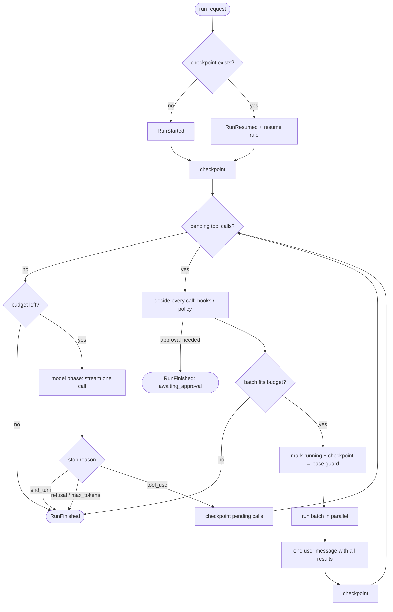
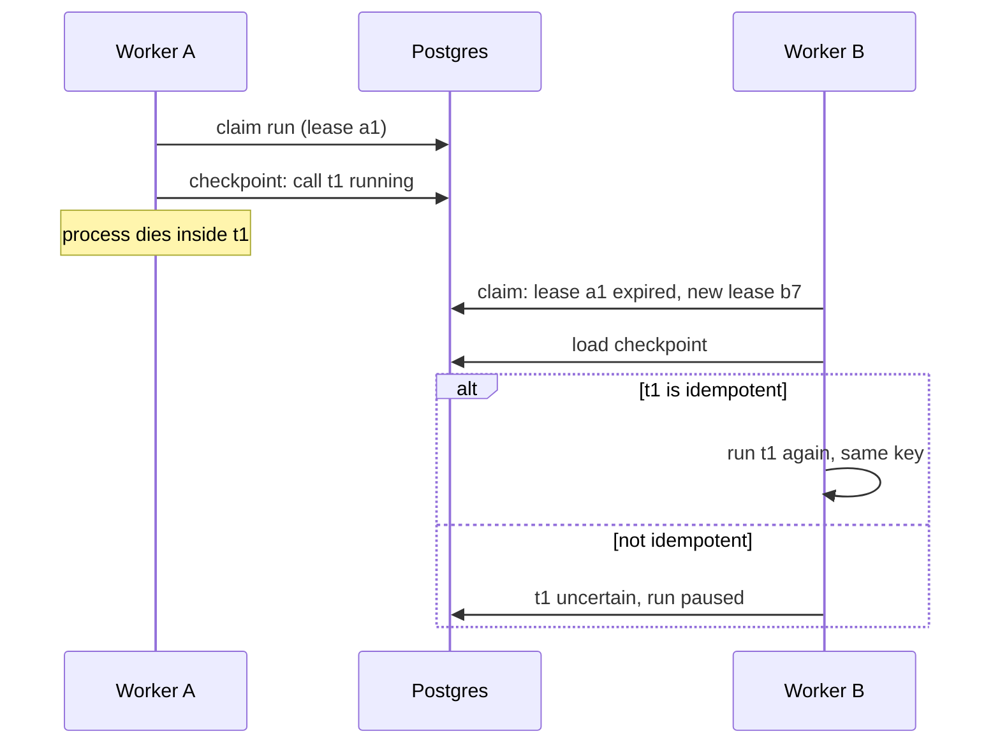

# The harness

How a run executes, how it survives crashes, and where to plug things in. The decisions behind it are in [ADR-001](adr/001-own-harness.md), [ADR-003](adr/003-durable-queue.md) and [ADR-005](adr/005-cassettes.md).

## Packages

| Package | Role |
|---|---|
| `kairos_domain` | Pydantic models: messages, `RunState`, `ModelRequest`/`ModelEvent`, `RunEvent`, tool specs and decisions |
| `kairos_harness` | `AgentLoop`, the seam Protocols, budgets and prices, cassettes, test doubles |
| `kairos_providers` | `MessagesProvider` for the Anthropic API and Bedrock (Mantle) |
| `kairos_tools` | `@tool` decorator, `ToolRegistry`, built-in tools |
| `kairos_db` | Migrations, `RunQueue` (leases), `PostgresCheckpointer` |
| `kairos_telemetry` | `TracingHooks` (GenAI semantic conventions), OTLP and OTLP/JSON export |
| `kairos_worker` | `Worker`, wiring, the `kairos` CLI |
| `kairos_evals` | Trace model, OTLP/JSON source, metrics, evaluator. Imports no other Kairos package |

## The loop



Rules the loop enforces:

- **History is append-only.** Messages are frozen models; the loop only appends. Thinking blocks travel as `OpaqueBlock` and are replayed byte-for-byte.
- **The system prompt is byte-stable** across steps (no timestamps), so the provider's prompt cache keeps hitting. A test asserts this.
- **A batch is all-or-nothing on decisions.** Every call is decided before any runs, so an approval pause never leaves half a batch executed.
- **The checkpoint before a batch is the lease guard.** If another worker owns the run, that save raises `LostLeaseError` before any side effect.
- **Streaming is ephemeral, completion is durable.** Text and tool-argument deltas carry no `seq` and are never stored. The `*_end` events carry complete values, so a model stream that fails halfway is retried with nothing to undo.
- **Untrusted tool output is wrapped** in `<untrusted_content>` with any forged closing tag neutralized, and the system prompt tells the model to treat it as data.

## Crash and resume

On resume, any tool call checkpointed as `running` has an unknown outcome:

| Tool | What happens |
|---|---|
| `idempotent=True` | Run again with the same idempotency key (the tool call id) |
| `idempotent=False` | Marked `uncertain`; the run pauses with `awaiting_input`. A human supplies the outcome through `RunContext.resolutions`, and the call is never silently re-sent |



## Extension points

- **Tools:** decorate an async function whose first parameter is a Pydantic model with `@tool(risk=..., idempotent=..., provenance=...)` and register it.
- **Hooks:** subclass `BaseHooks` and combine with `HookChain`. `before_tool` returns `Allow`, `Deny` or `RequireApproval`; this is where the M4 policy engine plugs in. Put `TracingHooks` last.
- **Providers:** implement `Provider.stream(ModelRequest) -> AsyncIterator[ModelEvent]` ending in `ModelCompleted`, raising `ProviderError(retryable=...)` on failure.

## Running it

```bash
just dev && just migrate
uv run kairos enqueue "What time is it in Toronto?"
just worker
```

`uv run kairos run "..."` runs once in memory with no database. Both need Anthropic credentials (or `KAIROS_PROVIDER=bedrock` with AWS credentials). `--replay FILE` serves model calls from a cassette instead.

To see traces in Langfuse, run `just dev-obs` and set `KAIROS_OTLP_ENDPOINT` and `KAIROS_OTLP_HEADERS` as described in `.env.example`.
